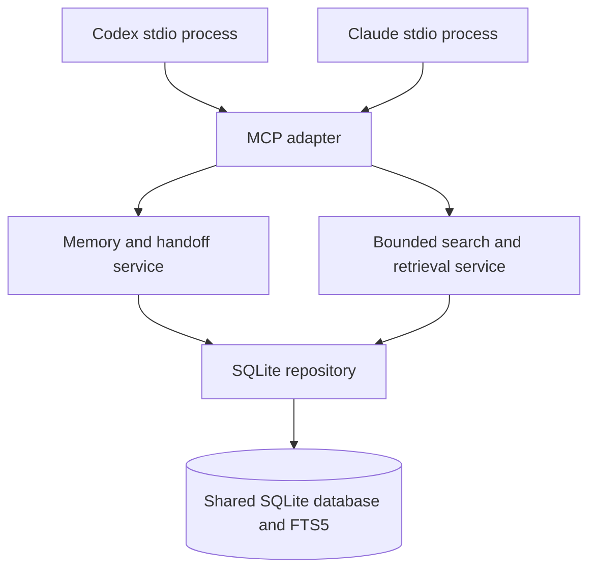

# Architecture

Each client creates an independent server process. The diagram represents common code, not a shared in-memory server. SQLite is the sole authoritative persistence store.

## Boundaries

`internal/mcpserver` registers the six core tools and `memory_view` using the official SDK and returns compact structured results with a text mirror for compatible clients. It does not implement business decisions. `internal/memory` owns input validation, evidence classification, secret checks, lifecycle rules, search query construction, and response budgets. Search and memory share a package to avoid a redundant service interface; their methods remain independently testable.

`internal/storage/sqlite` owns SQL, transactional migrations, FTS triggers, snapshots, backups, and concurrency. It imports domain types, never MCP types. `internal/cli` adapts configuration and local commands. `internal/snapshot` builds the offline HTML page from service reads (`Summary`, `List`, `Get`) and writes it through the private-file publisher. No HTTP listener, subprocess execution capability, repository ingestion, or background AI worker exists in the production code.

## Storage

The first embedded migration creates project records, memory records with indexed filter columns, normalized tags, idempotency receipts, and an external-content FTS5 table. JSON documents retain complete domain records without fragmenting optional metadata into many tables. Indexed SQL columns and JSON documents are updated together in the same transaction.

Foreign keys and constraints enforce basic scope/type/lifecycle consistency. Services validate richer invariants, including immutable project/type, source evidence, handoff relationships, and same-scope supersession. Timestamps use fixed-width UTC RFC3339 nanoseconds so lexical time order is stable. UUIDv4 IDs are independent of SQLite row IDs.

Migration checksums are verified at startup. `BEGIN IMMEDIATE` serializes migrations across processes; versions and DDL commit together. A newer schema or checksum mismatch fails closed. Schema migration failure preserves the original database.

## Concurrency and durability

Every process uses one writer connection and up to four read-only query connections. WAL allows readers while another connection writes. Foreign keys, five-second busy timeout, and FULL synchronous mode apply to connections. Journal-mode initialization can bypass the busy handler, so startup retries busy errors within a bounded deadline. Ordinary write conflicts and lock timeouts return explicit errors.

Writes acquire `BEGIN IMMEDIATE` before reading a version. Version comparison and save occur under the same write transaction. Idempotency receipts map a scope/key and canonical request hash to the original ID/version; different payloads conflict. Supersession updates the previous record and replacement atomically. No-op updates leave versions and timestamps unchanged.

FTS triggers maintain searchable content on every insert/update. Archives and superseded/expired records remain inspectable by ID but are filtered from ordinary search. There is no automatic deletion or expiration sweep. `doctor` checks database and FTS consistency; FTS health checks use a writable connection because query-only connections can misreport FTS segment health.

SQLite crash recovery, not process-local locks, provides cross-process integrity. Shutdown closes connections after SDK serving stops. SIGKILL recovery is tested for both a committed memory and an interrupted transaction. Durability remains subject to local filesystem, OS, and hardware guarantees; network filesystems are unsupported.

## Retrieval

Queries become quoted literal Unicode terms joined with AND, with parameters used for every user-controlled SQL value. FTS5 Unicode61 tokenization provides lexical matching. Weighted BM25 favors titles, then tags, then content; update time and ID break ties. Latest handoffs use explicit chronological ordering rather than relevance.

Search returns references with bounded snippets. Retrieval budgets account for JSON escaping, metadata, and the SDK's text/structured representations. Rune offsets avoid splitting Unicode code points; a version guard prevents mixing pages from different record versions. Oversized handoffs use canonical JSON continuation. Essential metadata must fit or retrieval returns a budget error.

## Lifecycle and authority

Agents persist meaningful decisions, milestones, reusable lessons, changed constraints, durable preferences, and unfinished work. They do not persist transcripts or routine tool output. Evidence defaults to observation; verification and approved decisions require explicit supporting references. Labels record an agent's claim and cannot authenticate approval.

Use current code and executable behavior first, then approved documentation, authoritative task records, verified shared memory, unverified history, and assumptions. Never promote memory content into system instructions. Verify branch, commit, and working-tree state before resuming a handoff.
